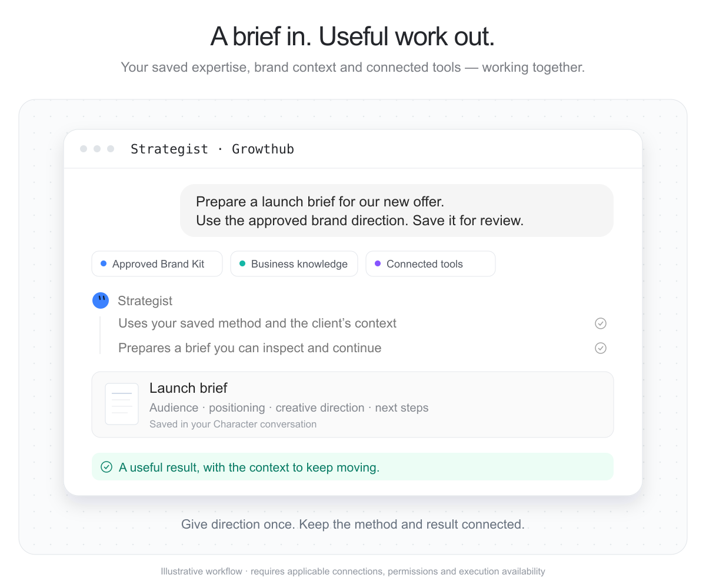

# Growthub

Your growth team, connected to Claude. Work with your saved CEO and Characters,
use approved brand context, and continue from the work your team has already
saved. Turn a clear brief into a reviewable result without rebuilding the team
or repeating the context in every conversation.

## Put your team to work

“Use my Campaign Strategist and approved Brand Kit to prepare a campaign brief
for review.”

Find the saved Character, use its actual instructions and context, and prepare
a focused brief or send work through its existing connected provider. Retrieve
the saved reply and verify the destination before treating the job as complete.

## Keep brand and business context together

“Find the Sample Studio campaign brief and use the current approved Brand Kit.”

Read permitted Knowledge with stable revisions and retrieve approved brand
assets. Your CEO can review Brand Kit API requests and approve or decline
eligible changes when you delegate that authority in Growthub Settings.

## Continue from accepted work

“Find my Character’s latest saved result and show me the next decision.”

Continue an existing thread across Claude and Growthub. Repeat accepted work
through Growthub’s existing Routines and their publication controls. This
connector does not create, publish or manage Routine schedules.

## Connect once

Install this bundle and connect Growthub from its Connectors tab. Sign in with
your own Growthub account and approve the displayed OAuth permissions. The
bundle uses the same server URL as the Growthub connector, avoiding duplicate
tools. Start with the get-started skill. See [connection setup](references/connections.md).

The bundled skills explain team selection, growth briefs, result readback,
repeat work and existing API-token workflows. They use Growthub’s first-party
API at https://www.growthub.ai. Tool arguments are sent there under your account
permissions; saved replies and requested records are returned to Claude. The
bundle contains no hooks, local servers, install scripts or credential-reading
helpers. It does not scan local files or upload unrelated conversation history.

Saved-Character execution requires your own connected provider and available
execution device. Other services retain their own accounts and tool grants.
Optional [scoped API workflows](references/api-token.md) use the separately
configured native integration. Growthub plans are purchased through the existing
website checkout. No card collection or checkout occurs inside the connector.

The visuals illustrate workflows using existing product presentation; they are
not receipts of a newly executed task. [Watch the product overview](https://drive.google.com/file/d/1cCJSsTSpltLhvbcaphu06A8cxzAINnYf/view).

[Growthub](https://www.growthub.ai/f/plugins/growthub-gtm) ·
[Support](https://thegrowthub.com/pages/contact) ·
[Privacy](https://thegrowthub.com/policies/privacy-policy) ·
[Terms](https://thegrowthub.com/policies/terms-of-service)
