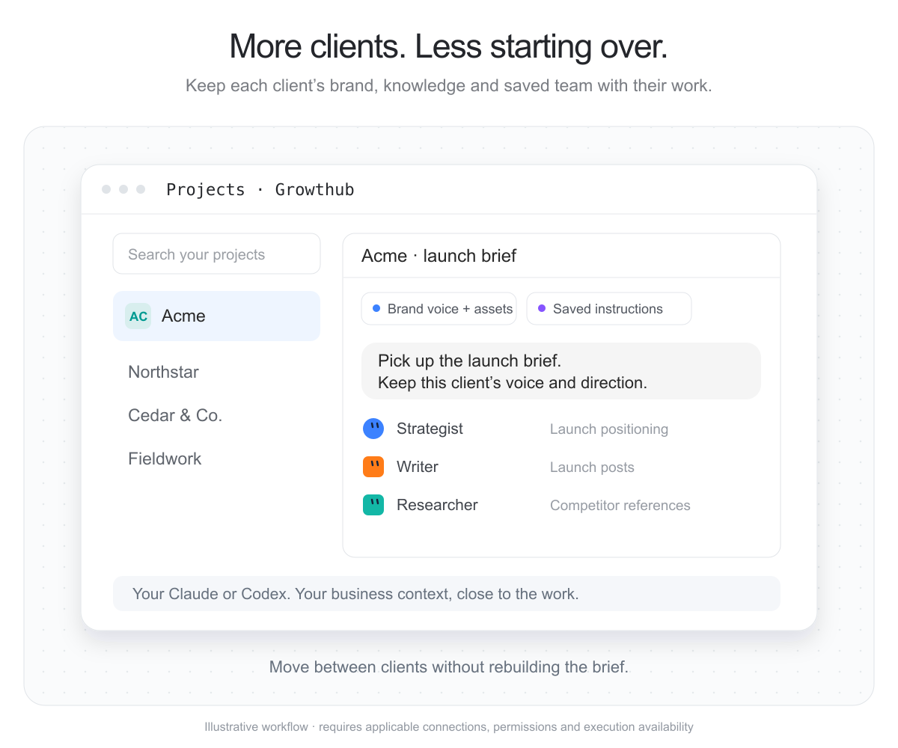
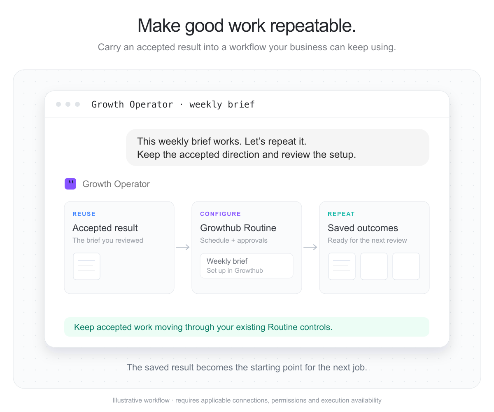

# Growthub

Bring your saved Growthub team, brand context and business tools to growth work.
Direct a Character, retrieve its saved result and repeat accepted work through
Growthub's existing Routines. The legacy governed console is separate local developer tooling; existing installations and its no-write contract remain unchanged.

## Install and use

From the existing public repository marketplace in Claude Code:

```text
/plugin marketplace add Growthub-ai/growthub-local
/plugin install growthub-gtm@growthub
```

For Codex, use the repository's existing Growthub marketplace and select
Growthub GTM Execution. Repository marketplace distribution and official OpenAI directory publication are separate. Use the published release and verify the supported connection path for your host.

Use your current Growthub account and existing token/connection settings. Where
supported, expose an already authorized token as GROWTHUB_API_TOKEN in the
provider process environment. Never paste it into chat, commit it or copy the
installed Growthub host's credential. Run the packaged get-started workflow.

Examples: research relevant prospects and save the list; prepare a campaign
brief and reviewable creative; prepare a sourced newsletter draft. Each task
uses the saved Character's provider, tool grants and current available device.

## Supported surfaces and evidence

| Surface | Connection / execution contract |
|---|---|
| Claude Code | Bundled remote MCP configuration with an existing token; installation and real task acceptance must be recorded for the released artifact. |
| Codex / compatible Work execution | Portable and Codex-compatible package plus existing token settings; CLI helper works where shell execution is available. Record installed-host acceptance separately. |
| ChatGPT or Claude OAuth-only chat | Existing Brand Kit OAuth works for approved brand reads. Full CEO/Knowledge access must use a demonstrated provider-supported existing connection; it is not implied by Brand Kit access. |
| Routines | Existing Growthub UI and publication/runtime owners. The current CEO MCP does not expose Routine lifecycle operations. |

The public OpenAI submission form's API-key connection limitation and the
existing token's actual scopes are release-readiness items, not reasons to
rewrite authentication. See [connections](references/connections.md).

## Development and review

plugins/growthub-gtm is the single source and public OpenAI submission package.
Run `node scripts/build-gtm-plugin.mjs` to generate the native installation
projections in codex-plugins/growthub-gtm and claude-plugins/growthub-gtm.
The Codex marketplace uses its compatibility projection: public review metadata
in portable mcp.json is not native runtime configuration. Install through the
marketplace rather than loading the public submission folder directly.
The package contains no hooks or automatic install-time
execution. Version 0.1.2 is independent of @growthub/cli because it wraps hosted
contracts and does not ship or pin that CLI.

The five skills use the current service owners. The growth-outcomes method adds
signup activation packets, customer winback drafts and weekly GTM briefs with
readiness checks, saved-result readback and cross-provider continuation. These
methods require live provider acceptance before release claims.
Tools are not entitlement or
send authority. A result needs the exact saved reply and destination readback;
an install, dispatch or digest alone does not establish business value.

[Growthub](https://www.growthub.ai/f/home) ·
[Support](https://thegrowthub.com/pages/contact) ·
[Privacy](https://thegrowthub.com/policies/privacy-policy) ·
[Terms](https://thegrowthub.com/policies/terms-of-service)

## API-token workflows

The bundled [API-token skill](skills/api-token/SKILL.md) and helper preserve the broader scoped API path for private Brand Kit creation, assets, Knowledge, gallery, usage and review-only proposals. These require a supported execution host and existing credentials; they are not implied MCP tools or ChatGPT web permissions.

## Visual examples

The listing graphics are illustrative workflows, not execution receipts. Real onboarding results are recorded separately.




